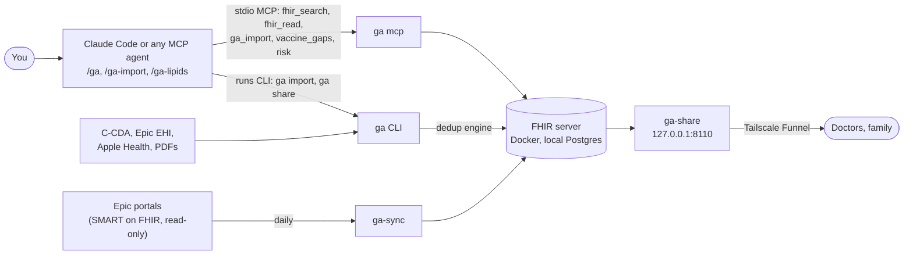

# GA (Guardian Angel)

[](https://github.com/seouri/ga-server/actions/workflows/test.yml) [](LICENSE) 

**All of your health records in one place, on your own computer, for your AI agent.** GA keeps one person's records in a local FHIR server and lets Claude Code, or any MCP agent, read them, import into them and share them. Hospital portals, Epic exports, Apple Health and lab PDFs land in one deduplicated record.

> **Not medical advice.** GA is not a medical device. Answers support a conversation with your clinician; they don't replace one. See [TERMS.md](TERMS.md).

## Quick start

You need [Docker Desktop](https://docs.docker.com/desktop/setup/install/mac-install/), [Node 26](https://nodejs.org/en/download) and [Claude Code](https://docs.anthropic.com/en/docs/claude-code/setup).

```sh
git clone https://github.com/seouri/ga-server.git && cd ga-server
./setup.sh      # checks Docker and Node, installs, starts GA, creates your record
claude          # start Claude Code in this folder; approve the ga-server MCP server once
```

Then bring in your records and ask:

```
> /ga-import ~/Downloads/apple_health_export
> /ga-import ~/Downloads/checkup-2024.pdf
> /ga Is starting Atorvastatin 40 mg the right decision?
> /ga Did I miss any vaccinations for my age?
> /ga-lipids since 2019
> Share my labs from the last 2 years with Dr. Kim for a week.
```

## How it works



Everything runs on your computer. It talks only to your own hospitals (to fetch your records), and your records leave it only to the people you share a link with and to your own AI provider (the agent you chat with, and share-link questions if you turn them on). The agent never talks to the FHIR server directly: it goes through GA's MCP tools and CLI, which add provenance, deduplication and scope checks.

## Documentation

| Guide | What's in it |
|---|---|
| [Using GA](docs/usage.md) | Slash commands and example prompts, other MCP agents, importing C-CDA, Epic EHI, Apple Health and PDFs, review flags |
| [Hospital portals](docs/hospital-portals.md) | Connecting Epic patient portals (MyChart) for daily automatic sync |
| [Registering GA with Epic](docs/epic-setup.md) | One-time Epic app registration, field by field |
| [Sharing](docs/sharing.md) | Private links for doctors and family: summary, PDF and FHIR downloads, questions |
| [Running GA](docs/operations.md) | Where data lives, **backup and restore**, uninstall, admin app |
| [Adding a skill](docs/skills.md) | Writing your own `/` command against GA |
| [AGENTS.md](AGENTS.md) | What an agent needs to know to read and write GA correctly |

## Status and limits

Early, and built for one person's own use. One patient per install. Runs on macOS; Linux should work (Docker plus Node 26) but is less tested. Hospital sync is tested with Epic only. Share links and daily sync work only while the computer running GA is awake and online.

## Contributing and security

See [CONTRIBUTING.md](CONTRIBUTING.md) (never commit real health data), and report vulnerabilities privately as described in [SECURITY.md](SECURITY.md).

## License

[Apache License 2.0](LICENSE). Use is also subject to [TERMS.md](TERMS.md).
