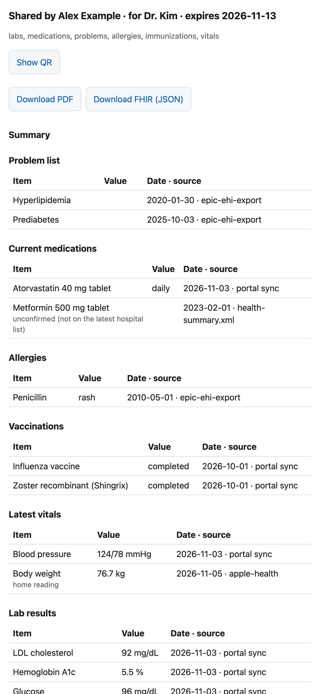

# Sharing with doctors and family

Back to the [README](../README.md).



`ga share` makes a private link to a read-only view of part of your record, for a doctor or family. They open it in any browser; no app or account. The link is the key: anyone who has it can see what it shares until it expires or you revoke it.

| `--for` | Shows (`--scope`) | Expires (`--expires`) | Layout | Questions a day (`--questions`) |
|---|---|---|---|---|
| `doctor` (default) | labs, medications, problems, allergies, immunizations, vitals | 7 days | A (one page) | 20 |
| `family` | all | never | B (tabs) | 20 |

Groups for `--scope`: labs, vitals, medications, problems, allergies, immunizations, visits, notes, procedures, family, messages, apple, or `all`. `--since 12m|2y|YYYY-MM-DD` and `--until YYYY-MM-DD` limit dated events; active problems, medications and allergies show whatever their date. `--expires 7d|12h|YYYY-MM-DD|never` (a date means through the end of that day). Portal status entries, provenance, the access log, the full EHI and Apple Health archives, imported source files (the original PDFs, C-CDA and EHI files) and the C-CDA document narrative (Composition, which includes insurance) are never shared; only the records extracted from them are.

```sh
ga share --for doctor --label "Dr. Kim"                 # link + QR code, scope and expiry
ga share --for family --label Mom --scope labs,vitals,medications --since 2y
ga shares                                               # id, label, audience, scope, expiry, status, last access, accesses
ga shares show <id>                                     # the link and QR again
ga revoke <id>                                          # works at once, no restart
ga share log [<id>]                                     # who opened what, when, from which IP; questions asked
ga share export <id> [--out dir]                        # <Name>_health-summary_<date_time>.pdf and <Name>_health-records-FHIR_<date_time>.json, mode 0600
```

**From Claude Code.** Ask in plain words, with or without `/ga`: "/ga share my labs and medications from the last 2 years with Dr. Kim for a week", "share everything with Mom, no expiry", "list my shares", "revoke the Dr. Kim share", "who opened Mom's link?". Claude shows the parsed audience, scope, dates and expiry and runs `ga share …` only after you confirm. The terminal QR code may not survive in the chat; ask for the link, open it on your phone, and tap **Show QR**.

**From chat apps.** Connected apps ([GA from chat apps](chat-apps.md)) have `share_create`, `share_list`, `share_log` and `share_revoke`. `share_create` first returns a preview (audience, scope, dates, expiry) and a link to GA's confirm page; the share is made only when you press Confirm there (passkey sign-in), and the page shows its link and QR code.

**Turning on links.** `docker compose up -d` starts `ga-gateway`, which serves the links on `127.0.0.1:8110` only. Tailscale Funnel puts it on the internet over HTTPS:

1. In the Tailscale admin console, turn on MagicDNS and HTTPS certificates (DNS page) and allow Funnel for your tailnet (Access controls: the `funnel` node attribute; Tailscale offers to add it the first time).
2. On the GA Mac: `tailscale funnel --bg 8110` (the macOS app's CLI is `/Applications/Tailscale.app/Contents/MacOS/Tailscale`). `ga share` checks `tailscale funnel status` and prints this command if Funnel is off; it never turns Funnel on itself. `tailscale funnel reset` turns it off (and clears any other `tailscale serve` setup).

Links use your machine's Tailscale name (`https://<machine>.<tailnet>.ts.net/s/...`), so every recipient sees it; rename the machine in Tailscale if you mind. `GA_SHARE_URL` overrides the base URL.

**Links work only while the GA Mac is awake and online.** For a patient portal upload, an email attachment or anyone who needs it offline, use `ga share export` and send the files instead.

**Questions.** Recipients can ask an AI model about what the link shows, answered from the shared records only. Any provider with an OpenAI-compatible Chat Completions API works, as long as the model supports tool calling. Put three lines in `.env` (gitignored), then run `docker compose up -d ga-gateway`:

| Provider | `GA_LLM_BASE_URL` | `GA_LLM_API_KEY` | `GA_LLM_MODEL` (example) |
|---|---|---|---|
| Ollama on this computer (free; records never leave it) | `http://host.docker.internal:11434/v1` | leave empty | `qwen3` |
| OpenAI | leave empty | your key | `gpt-5` |
| Google Gemini | `https://generativelanguage.googleapis.com/v1beta/openai/` | your key | `gemini-2.5-pro` |
| Anthropic | `https://api.anthropic.com/v1/` | your key | `claude-opus-5-5` |
| OpenRouter | `https://openrouter.ai/api/v1` | your key | any listed model |

Without `GA_LLM_MODEL` the page says questions are not set up; `docker compose logs ga-gateway` shows which model is in use. Shared records go to the provider you pick, so choose one whose terms you accept for health data (free tiers of some cloud APIs may use prompts for training). Small local models are weaker at tool calling and may answer "Sorry" more often. For Ollama, `ollama pull qwen3` first; on Linux also start it with `OLLAMA_HOST=0.0.0.0` so the container can reach it.

Cost cap: each link allows `--questions` questions a day (default 20), and each answer is bounded in turns and tokens. Questions are kept in the access log; answers are not.

**Log.** Every view, download and question is a local AuditEvent in GA's FHIR server (tag `urn:ga-server:share|<id>`), never shared. Share settings are in `.ga/share/shares.json`; link tokens are encrypted beside them.

**Troubleshooting.** `curl -s -o /dev/null -w '%{http_code}' http://127.0.0.1:8110/` should print `404` (only `/s/<token>` routes exist); if it fails, `docker compose logs ga-gateway`. If links work on the GA Mac but not from a phone on mobile data, a firewall on the Mac (macOS Firewall, Little Snitch, a VPN or security app) is blocking Tailscale's incoming Funnel traffic: allow Tailscale. Test from outside your tailnet; the GA Mac itself can't reach its own Funnel address through the public relay. If `ga share log` shows the same IP for every visitor, Funnel is not passing the client IP in `X-Forwarded-For`: the failed-link rate limit then applies to everyone at once; see the `[check]` note on `X-Forwarded-For` in `src/share/server.ts`.
